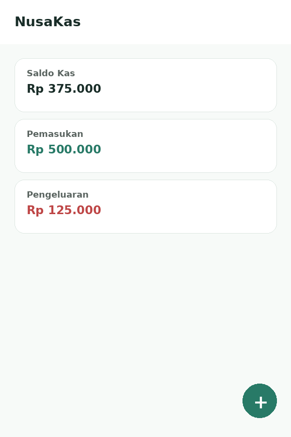
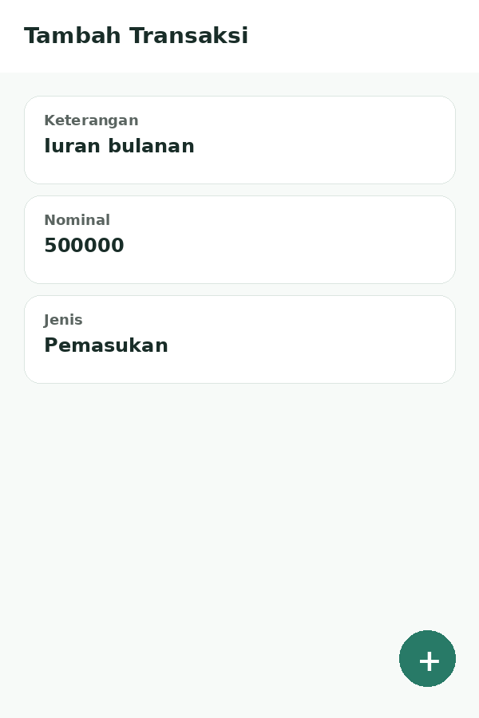
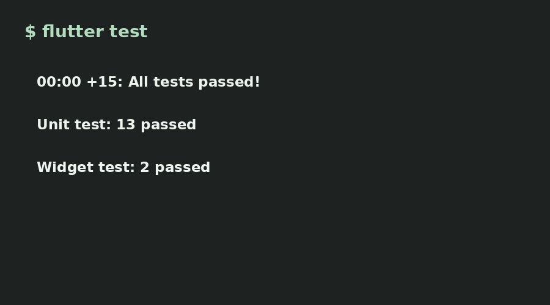
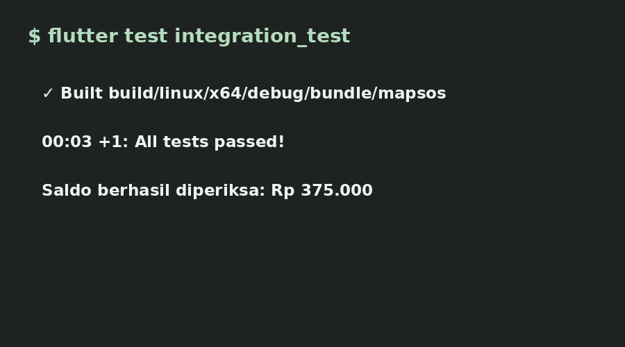

# NusaKas

Aplikasi Flutter sederhana untuk mencatat pemasukan dan pengeluaran kas himpunan.

## Fitur

- Melihat saldo, total pemasukan, dan total pengeluaran.
- Menambah pemasukan atau pengeluaran dengan validasi.
- Menghapus transaksi menggunakan `Dismissible`.
- Menolak nominal nol/negatif dan pengeluaran melebihi saldo.

## Menjalankan

```sh
flutter pub get
flutter run
```

## Pengujian

```sh
flutter test
flutter test integration_test
```

## Struktur

- `lib/domain/`: model dan kalkulator kas.
- `lib/data/repositories/`: penyimpanan transaksi dalam memori.
- `lib/ui/kas/`: view model dan halaman UI.
- `test/unit/`: unit test.
- `test/widget/`: widget test.
- `integration_test/`: integration test.

## Screenshot

### Halaman Home



### Halaman Tambah Transaksi



### Hasil `flutter test`



### Hasil integration test


